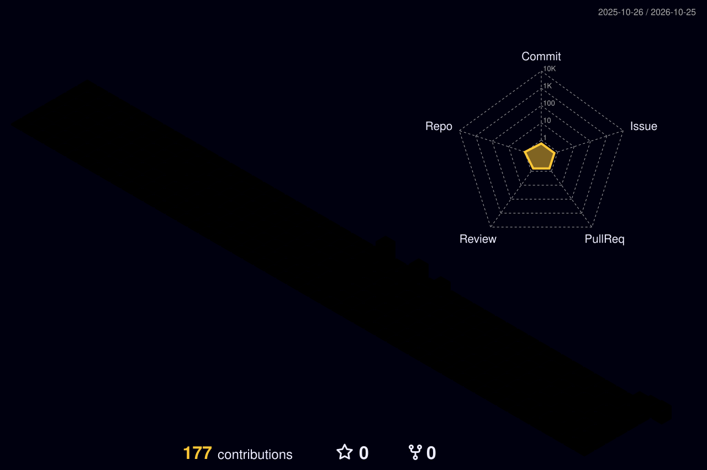

 

> **Solving real-world problems through code into _impactful_ digital solutions.**
> I thrive at the intersection of clean architecture and thoughtful design — from resilient backends to polished interfaces.

- 🏥 **Domain** — HRIS, POS, LMS, hospital systems (SIMRS) & **BPJS / SATUSEHAT** bridging
- 📱 **Cross-platform** — one backend → web + Android + iOS with **Flutter**
- ☁️ **Cloud** — AWS certified · PostgreSQL · realtime & AI-powered features
- 🤖 **Fun fact** — my site has its own chatbot, go ask [*Harris AI*](https://harris.web.id) anything

 

<b>F R O N T E N D</b> 
&nbsp;&nbsp;
&nbsp;&nbsp;
&nbsp;&nbsp;
&nbsp;&nbsp;
&nbsp;&nbsp;
&nbsp;&nbsp;
&nbsp;&nbsp;
&nbsp;&nbsp;

 <b>B A C K E N D</b> 
&nbsp;&nbsp;
&nbsp;&nbsp;
&nbsp;&nbsp;
&nbsp;&nbsp;
&nbsp;&nbsp;
&nbsp;&nbsp;
&nbsp;&nbsp;

 <b>M O B I L E &nbsp;·&nbsp; D A T A B A S E &nbsp;·&nbsp; C L O U D</b> 
&nbsp;&nbsp;
&nbsp;&nbsp;
&nbsp;&nbsp;
&nbsp;&nbsp;
&nbsp;&nbsp;
&nbsp;&nbsp;
&nbsp;&nbsp;
&nbsp;&nbsp;
&nbsp;&nbsp;

 

👆 Click any card to open the live app

 

 

 

🐍 <b>The snake is hungry for my commits…</b>

<picture>
  <source media="(prefers-color-scheme: dark)" srcset="https://raw.githubusercontent.com/harrisreza/harrisreza/output/github-snake-dark.svg"/>
  <source media="(prefers-color-scheme: light)" srcset="https://raw.githubusercontent.com/harrisreza/harrisreza/output/github-snake.svg"/>
  
</picture>

🟡 <b>…while Pac-Man runs from the ghosts 👻</b>

<picture>
  <source media="(prefers-color-scheme: dark)" srcset="https://raw.githubusercontent.com/harrisreza/harrisreza/output/pacman-contribution-graph-dark.svg"/>
  <source media="(prefers-color-scheme: light)" srcset="https://raw.githubusercontent.com/harrisreza/harrisreza/output/pacman-contribution-graph.svg"/>
  
</picture>

 

