

  
  
  

 

<picture>
  <source media="(prefers-color-scheme: dark)" srcset="./assets/title-stack-dark.svg"/>
  <source media="(prefers-color-scheme: light)" srcset="./assets/title-stack-light.svg"/>
  
</picture>

  
  <a href="https://developer.mozilla.org/docs/Web/CSS">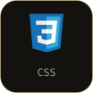</a>
  
  <a href="https://www.typescriptlang.org">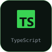</a>
  
  
  <a href="https://vuejs.org">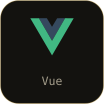</a>
  <a href="https://tailwindcss.com">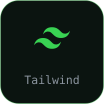</a>
  
   
  <a href="https://nodejs.org">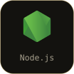</a>
  
  <a href="https://laravel.com">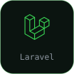</a>
  <a href="https://codeigniter.com">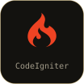</a>
  
  
  
  
  
   
  <a href="https://dart.dev">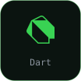</a>
  
  
  
  <a href="https://firebase.google.com">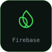</a>
  
  
  <a href="https://vercel.com">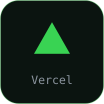</a>
  <a href="https://git-scm.com">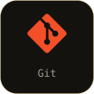</a>

 

<picture>
  <source media="(prefers-color-scheme: dark)" srcset="./assets/title-projects-dark.svg"/>
  <source media="(prefers-color-scheme: light)" srcset="./assets/title-projects-light.svg"/>
  
</picture>

  
  
  
  
  

 

<picture>
  <source media="(prefers-color-scheme: dark)" srcset="./assets/title-stats-dark.svg"/>
  <source media="(prefers-color-scheme: light)" srcset="./assets/title-stats-light.svg"/>
  
</picture>

  

<picture>
  <source media="(prefers-color-scheme: dark)" srcset="./assets/title-arcade-dark.svg"/>
  <source media="(prefers-color-scheme: light)" srcset="./assets/title-arcade-light.svg"/>
  
</picture>

<picture>
  <source media="(prefers-color-scheme: dark)" srcset="https://raw.githubusercontent.com/harrisreza/harrisreza/output/github-snake-dark.svg?v=3"/>
  <source media="(prefers-color-scheme: light)" srcset="https://raw.githubusercontent.com/harrisreza/harrisreza/output/github-snake.svg?v=3"/>
  
</picture>

<picture>
  <source media="(prefers-color-scheme: dark)" srcset="https://raw.githubusercontent.com/harrisreza/harrisreza/output/pacman-contribution-graph-dark.svg?v=3"/>
  <source media="(prefers-color-scheme: light)" srcset="https://raw.githubusercontent.com/harrisreza/harrisreza/output/pacman-contribution-graph.svg?v=3"/>
  
</picture>

  

